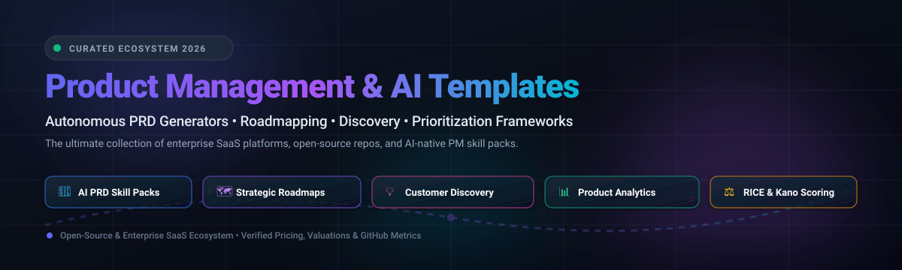
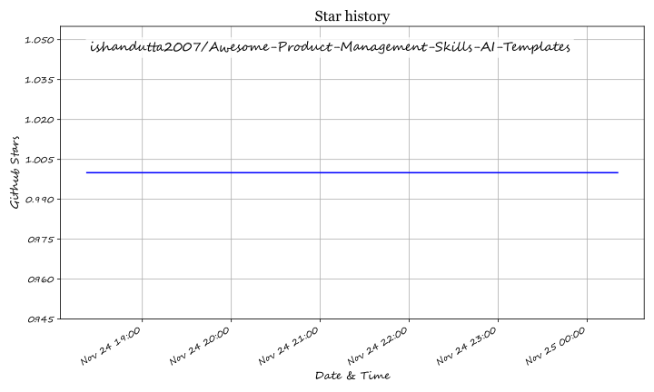

# 🚀 Awesome-Product-Management-Skills-AI-Templates

  
  
  
  
  
  
  

  <strong>Curated directory of top Product Management software, AI PM skill packs, PRD generators, customer feedback portals, prioritization frameworks, and product analytics tools.</strong>

---

A comprehensive, SEO-optimized guide tracking notable **SaaS platforms** and **open-source GitHub projects** engineered for modern product managers, AI-native software builders, product operations teams, startup founders, and autonomous coding agents.

---

## 📑 Table of Contents

- [📊 Sector Overview & Market Dynamics](#-sector-overview--market-dynamics)
- [☁️ SaaS/Hosted Platforms](#️-saashosted-platforms)
- [🔓 Open-Source GitHub Projects](#-open-source-github-projects)
- [🤝 How to Contribute](#-how-to-contribute)
- [💖 Support](#-support)
- [⭐ Star History](#-star-history)
- [⚖️ Disclaimer](#️-disclaimer)

---

## 📊 Sector Overview & Market Dynamics

The global product management software and AI-assisted workflow sector is valued at approximately **$8.4B to $10.1B** and is projected to expand to **$22.7B–$23.7B** over the next decade at a compound annual growth rate (**CAGR**) of **9.9%–11.6%**. 

Market dynamics exhibit a **hybrid competitive structure**: the enterprise tier is **moderately concentrated** (with top incumbents such as Atlassian, Amplitude, and Productboard capturing 40%–45% of total market revenue through multi-product platform consolidation), while the mid-to-lower tiers remain **highly fragmented**, characterized by fierce competition among specialized point solutions for customer feedback, AI PRD drafting, feature-voting portals, and modular open-source developer stacks.

---

## ☁️ SaaS/Hosted Platforms

The following SaaS platforms provide hosted product discovery, roadmapping, PRD creation, and feedback management. Table entries are sorted in **descending order by company valuation / revenue scale**.

| Product | 🏢 Valuation / Revenue Scale | 💵 Starting Price | 🎁 Free Tier Limits / Free Trial Limits | ⚡ Key Capabilities |
| :--- | :--- | :--- | :--- | :--- |
| **[Jira Product Discovery (Atlassian)](https://atlassian.com/software/jira/product-discovery)** | **$34B Valuation** (Public: NASDAQ: TEAM) | $10/creator/month (billed monthly) or $100/creator/year (Standard) | **Free forever plan**: Up to 3 creators, unlimited contributors/viewers, 2 GB total storage, and 100 automation rule runs/month. | Ideation, weighted prioritization matrix, and roadmap workspace deeply integrated with Jira delivery epics. |
| **[Productboard](https://productboard.com)** | **$1.7B Valuation** ($125M Series D) | $19/maker/month (billed annually) / $25 billed monthly (Plus tier) | **Free forever plan**: 1 maker, up to 25 contributors, 500 feedback notes, 1 teamspace, 1 product portal, and limited shared AI Spark credits. | Customer-centric product system unifying user feedback repositories, AI insights extraction, and roadmaps. |
| **[Aha! Roadmaps & Ideas](https://aha.io)** | **>$100M ARR** (Bootstrapped & Profitable) | $59/user/month (billed annually, Premium plan) | **No free tier**; 30-day full-featured free trial with all Premium capabilities and unlimited test records. | Comprehensive product development suite connecting OKRs, customer idea portals, and AI-assisted PRD drafting. |
| **[Dragonboat](https://dragonboat.io)** | **~$48M Valuation** ($17.3M raised; ~$3.4M ARR) | ~$49/editor/month (billed annually; enterprise portfolio tiers scale $6k–$60k+/yr) | **No free tier**; 14-day free trial available via guided onboarding/demo sandbox. | Responsive strategic portfolio management (SPM) aligning roadmaps, engineering capacity, and enterprise OKRs. |
| **[Airfocus](https://airfocus.com)** | **Acquired by Lucid** (Estimated tens of millions valuation) | ~$59/user/month (Professional tier estimate; custom quotes) | **No free tier / No self-serve trial**; requires personalized sales demo sandbox evaluation. | Modular product management platform offering weighted scoring frameworks, priority poker, and AI roadmapping. |
| **[Roadmunk (Tempo)](https://roadmunk.com)** | **Acquired by Tempo Software** (~$12.5M revenue at acquisition) | $19/user/month (billed annually, Starter plan; Business at $49/user/month) | **No free tier**; 14-day full-featured free trial including timeline, swimlane views, and feedback inbox. | Collaborative roadmapping tool built for executive timeline and board-ready swimlane presentations. |
| **[Craft.io](https://craft.io)** | **~$7M ARR** ($8M VC funding raised) | $39/editor/month (billed annually, Pro plan) / $49 billed monthly | **No free tier**; 14-day full-featured free trial on Pro tier with unlimited free stakeholder/viewer access. | End-to-end product management workspace featuring spec editors, capacity planning, and custom prioritization scoring. |
| **[Chisel Labs](https://chisellabs.com)** | **Acquired by Pendo** (Feb 2026; $4.8M previously raised) | $49/maker/month (billed annually) / $59 billed monthly (Premium plan) | **Free forever plan (Essential)**: 1 maker, unlimited roadmaps, up to 1,000 feedback items, and basic team alignment surveys. | Agile product management platform combining roadmapping, team alignment surveys, and AI PRD generation. |
| **[Cycle.app](https://cycle.app)** | **VC-backed** (Boldstart; Seed / Subsidiary integration) | $15/maker/month (billed annually, Pro tier) | **Free forever plan (Starter)**: 1 maker, basic feedback capture from Slack, simple roadmaps, and limited AI processing. | AI-powered feedback hub that captures voice and text insights from Slack, Gong, and Intercom into living product specs. |
| **[ProdPad](https://prodpad.com)** | **~$1.5M ARR** (Bootstrapped private SaaS) | $24/editor/month per module (Roadmaps, Ideas, or Feedback; $72/mo bundle) | **No free forever tier**; dynamic 7-day free trial (extendable up to 30 days by completing onboarding milestones). | Lean product management suite pioneering Now-Next-Later outcome roadmaps, backlog triage, and AI customer synthesis. |

---

## 🔓 Open-Source GitHub Projects

Curated open-source product management tools, agentic PM prompt skill kits, self-hosted customer feedback boards, and product analytics platforms. Repositories are sorted in **descending order by GitHub stargazers count**.

| Project | ⭐ GitHub_Stars | 🎯 Focus Area | 📝 Description |
| :--- | :--- | :--- | :--- |
| **[Spec-Kit](https://github.com/github/spec-kit)** |  | Spec-Driven Dev / PRDs | Open-source toolkit and structured schema for turning product intent into executable technical specs and user stories for AI agents. |
| **[Excalidraw](https://github.com/excalidraw/excalidraw)** |  | Discovery & Wireframing | Virtual collaborative whiteboard for customer journey mapping, architecture diagramming, and product wireframing. |
| **[Hoppscotch](https://github.com/hoppscotch/hoppscotch)** |  | API Discovery & Specs | Open-source API development ecosystem used by technical product managers to test endpoints, validate specs, and prototype integrations. |
| **[AppFlowy](https://github.com/AppFlowy-IO/AppFlowy)** |  | Local-First PRDs & Wikis | Open-source, offline-first workspace alternative to Notion combining PRD templates, Kanban backlogs, and relational databases. |
| **[AFFiNE](https://github.com/toeverything/AFFiNE)** |  | Workspace & Brainstorming | Integrated product workspace merging docs, whiteboards, and visual canvas roadmaps for early-stage product discovery. |
| **[NocoDB](https://github.com/nocodb/nocodb)** |  | No-Code Feature Matrices | Open-source Airtable alternative turning any database into smart relational spreadsheets for RICE scoring and product backlog triage. |
| **[Plane](https://github.com/makeplane/plane)** |  | Product Planning & Issues | Modern open-source project and product planning suite featuring Pages (collaborative PRDs), Modules, Cycles, and timeline roadmaps. |
| **[Twenty](https://github.com/twentyhq/twenty)** |  | Customer Discovery CRM | Open-source CRM providing product teams direct pipeline visibility, customer interview tracking, and account-level feedback synthesis. |
| **[BMAD-METHOD](https://github.com/bmad-code-org/BMAD-METHOD)** |  | Multi-Agent PM Framework | Multi-agent agile framework providing dedicated PM, Product Owner, Analyst, and Architect agent personas with structured PRD templates. |
| **[Metabase](https://github.com/metabase/metabase)** |  | Product Metrics & BI | The simplest self-hosted business intelligence and data exploration tool for product KPIs, user retention, and activation funnels. |
| **[Fabric](https://github.com/danielmiessler/fabric)** |  | AI PM Prompt Patterns | Modular AI prompt framework containing production-ready patterns for PRD critique, user story extraction, and competitive teardowns. |
| **[Outline](https://github.com/outline/outline)** |  | Knowledge Base & Specs | Lightning-fast, collaborative open-source team knowledge base ideal for living PRDs, RFCs, and engineering handoff documentation. |
| **[PostHog](https://github.com/PostHog/posthog)** |  | Product Analytics OS | All-in-one product operating system uniting product event analytics, session replay, feature flags, A/B testing, and user feedback surveys. |
| **[Chatwoot](https://github.com/chatwoot/chatwoot)** |  | User Feedback & Support | Open-source omnichannel customer support platform allowing PMs to review customer pain points directly from live conversations. |
| **[phuryn/pm-skills](https://github.com/phuryn/pm-skills)** |  | AI PM Skills & Templates | Curated open-source collection of modular AI skills, prompts, and templates tailored for Product Managers across discovery, PRDs, and roadmaps. |
| **[Promptfoo](https://github.com/promptfoo/promptfoo)** |  | AI Evaluation & Quality | Test framework and CLI for product teams building GenAI features to evaluate prompt reliability, safety, and output regressions. |
| **[Unleash](https://github.com/Unleash/unleash)** |  | Feature Flags & Rollouts | Enterprise open-source feature management platform enabling progressive releases, dark launches, and targeted user rollouts. |
| **[Formbricks](https://github.com/formbricks/formbricks)** |  | In-App Feedback & Surveys | Open-source experience management suite allowing PMs to trigger targeted in-app micro-surveys and PMF score assessments. |
| **[Leantime](https://github.com/Leantime/leantime)** |  | Lean Product Management | Strategic product and project management system featuring Lean Canvas, SWOT analysis, idea boards, and milestone roadmaps. |
| **[GrowthBook](https://github.com/growthbook/growthbook)** |  | Feature Flags & A/B Tests | Open-source feature flagging and experimentation platform offering Bayesian and Frequentist statistics engines for growth PMs. |
| **[Fider](https://github.com/getfider/fider)** |  | Feature Voting & Ideas | Clean, open-source customer voice and idea voting portal allowing product teams to collect and discuss user feature requests publicly. |
| **[Astuto](https://github.com/astuto/astuto)** |  | Feedback & Roadmaps | Free, open-source self-hosted customer feedback tool for collecting feature requests, upvoting, and sharing transparent public roadmaps. |
| **[LogChimp](https://github.com/logchimp/logchimp)** |  | Feedback Tracking | Lightweight open-source platform for capturing customer feedback, prioritizing requests, and publishing product roadmaps. |
| **[Frappe Insights](https://github.com/frappe/insights)** |  | Self-Hosted Analytics | Free, open-source self-hosted product analytics and business intelligence tool designed for rapid query building and funnel analysis. |
| **[ClearFlask](https://github.com/clearflask/clearflask)** |  | Feedback & Changelogs | Open-source community feedback, public roadmap, idea voting, and changelog platform designed as a self-hosted alternative to Canny. |

---

## 🤝 How to Contribute

We welcome contributions from product managers, founders, engineers, and AI practitioners! 💡

1. Fork this repository 🍴.
2. Add or update entries in `README.md`:
   - 🏢 For SaaS tools: ensure pricing, free tier/trial limits, and valuation/revenue scale are backed by public sources.
   - 💻 For Open-Source repos: ensure the repository link is valid and include the stargazer badge (`style=social&color=white`) linking directly to `/stargazers`.
3. Keep descriptions factual, concise, and focused on product management value.
4. Submit a Pull Request with a clear title and summary of changes 🚀.

---

## 💖 Support

Thank you for exploring this curated repository! If you find this collection helpful for your product discovery, roadmapping, and AI-native PM workflows:

- ⭐ **Star this repository** to show your support and help others discover it.
- 🍴 **Fork it** to customize your personal PM toolkit or contribute back.
- 📢 **Share it** with your team, fellow product managers, and builders.
- ☕ **Buy a coffee / Sponsor**: If you'd like to support ongoing curation and open-source maintenance, consider sponsoring via the [GitHub Sponsors Dashboard](https://github.com/sponsors/ishandutta2007).

---

##  Star History

---

## ⚖️ Disclaimer

- This list is a community-curated educational resource; inclusion does not constitute endorsement.
- All product pricing, tier limits, and valuation figures reflect publicly available data as of November 2026 and are subject to change by their respective providers.
- When generating PRDs, specifications, or user personas with AI models or agent frameworks, always review and validate outputs against real customer research and engineering architecture requirements.

---

  Built with ❤️ for product managers, AI-native builders, startup founders, and product operations teams.

## Star History

<a href="https://star-history.com/#ishandutta2007/Awesome-Product-Management-Skills-AI-Templates&Timeline" align="center">
  <picture>
    <source media="(prefers-color-scheme: dark)" srcset="assets/ishandutta2007_Awesome-Product-Management-Skills-AI-Templates_growth.svg">
    
  </picture>
</a>
